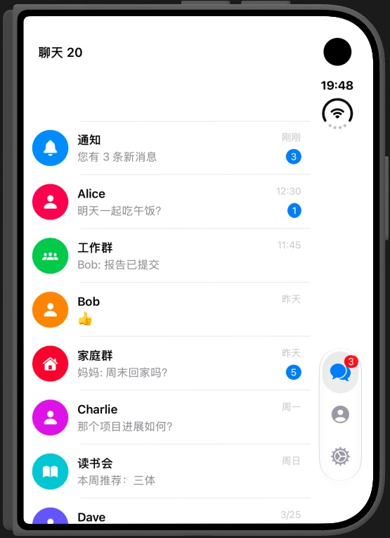
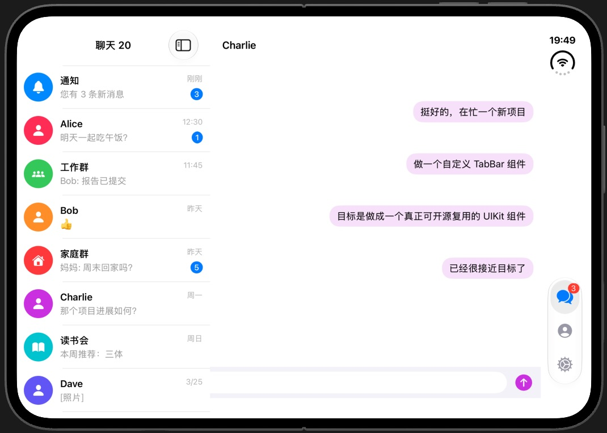

# TabBar

[](https://github.com/sunimp/TabBar/actions/workflows/ci.yml)
[](https://swift.org/package-manager/)
[](LICENSE)

UIKit 自定义 TabBar，支持浮动胶囊、液态选中效果、角标和 Lottie 图标动画，并适配 iPhone Duo 的侧边纵向布局。

## 特性

- iOS 15+、Swift Package Manager。
- `UIImage` 和 Lottie 图标。
- 亮色、暗色和自定义样式。
- 选中、重选、双击和长按回调。
- iPhone Duo 纵向 TabBar、safe area 避让和双栏 Demo。

## 安装

在 Xcode 中添加：

```text
https://github.com/sunimp/TabBar.git
```

或在 `Package.swift` 中添加：

```swift
.package(url: "https://github.com/sunimp/TabBar.git", from: "0.1.0")
```

## 快速开始

```swift
import TabBar
import UIKit

let controller = TabBarController()
controller.setViewControllers(
    [UIViewController(), UIViewController()],
    items: [
        TabBarItem(title: "首页", image: UIImage(systemName: "house")),
        TabBarItem(title: "设置", image: UIImage(systemName: "gear")),
    ]
)
```

主要类型：`TabBarController`、`TabBarView`、`TabBarItem`、`TabBarItemAnimation`、`TabBarStyle`。

## Demo

打开 `Demo/TabBarDemo.xcodeproj`，运行 `TabBarDemo` scheme。

| iOS 15+ 亮色 | iOS 15+ 暗色 |
| --- | --- |
|  |  |

| iOS 26+ 亮色 | iOS 26+ 暗色 |
| --- | --- |
|  |  |

| iPhone Duo 闭合外屏 | iPhone Duo 展开内屏 |
| --- | --- |
|  |  |

Duo 姿态使用 Xcode Device Hub 验证。闭合外屏使用侧边纵向 TabBar；展开内屏使用会话列表与详情双栏布局。

## 验证

运行测试：

```bash
xcodebuild test \
  -scheme TabBar \
  -destination "platform=iOS Simulator,id=${DESTINATION_ID}"
```

构建 Demo：

```bash
xcodebuild build \
  -project Demo/TabBarDemo.xcodeproj \
  -scheme TabBarDemo \
  -destination "generic/platform=iOS Simulator" \
  CODE_SIGNING_ALLOWED=NO
```

如需重新生成 Demo 工程：

```bash
cd Demo && xcodegen generate
```

## License

MIT，详见 [LICENSE](LICENSE)。
