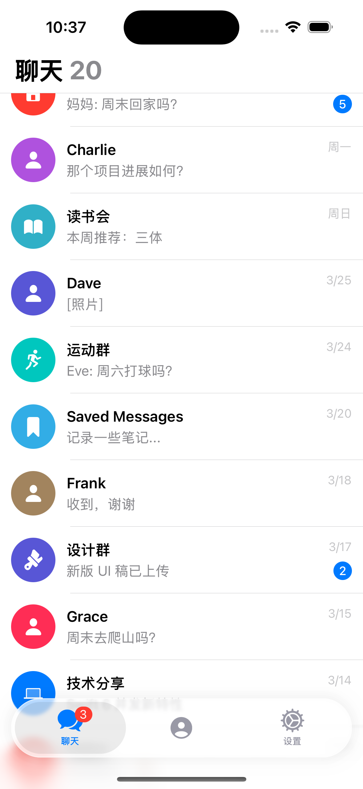
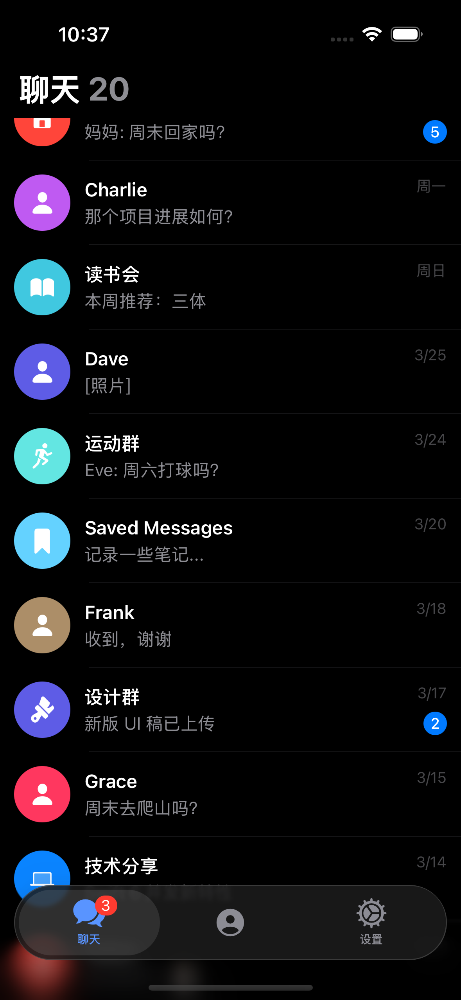
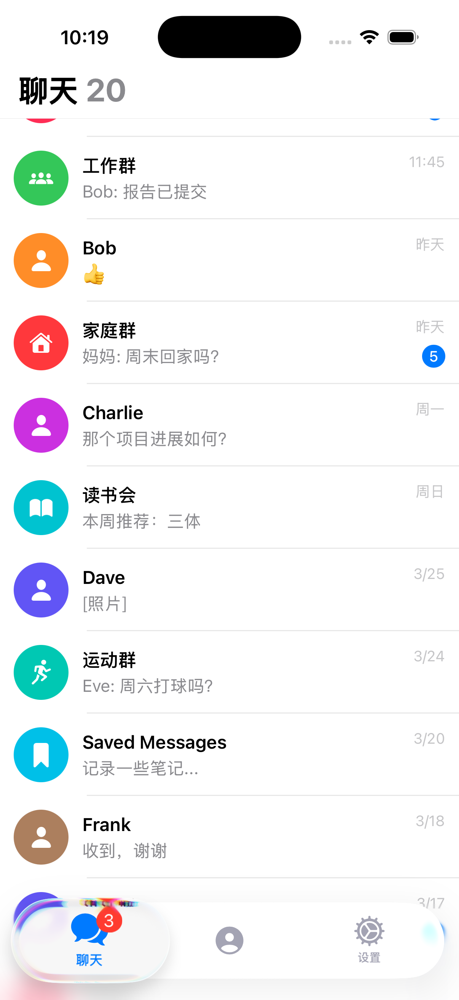
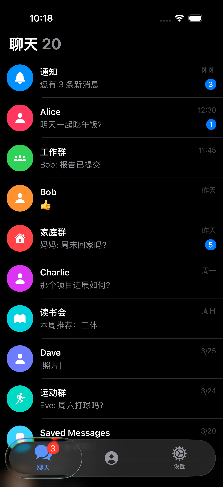
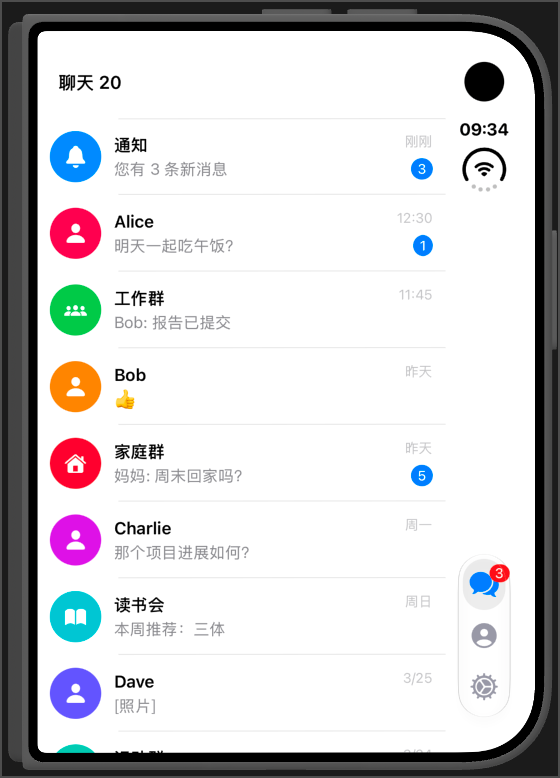
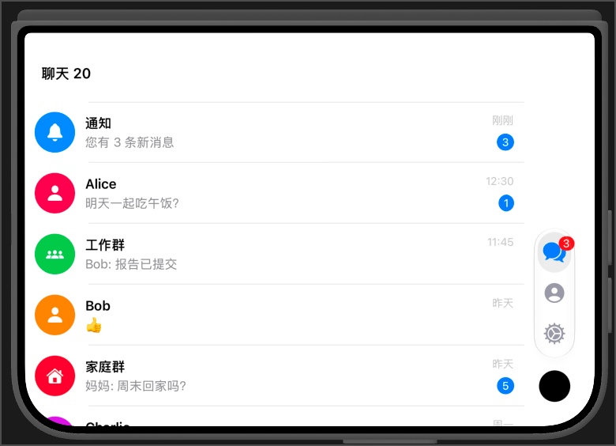
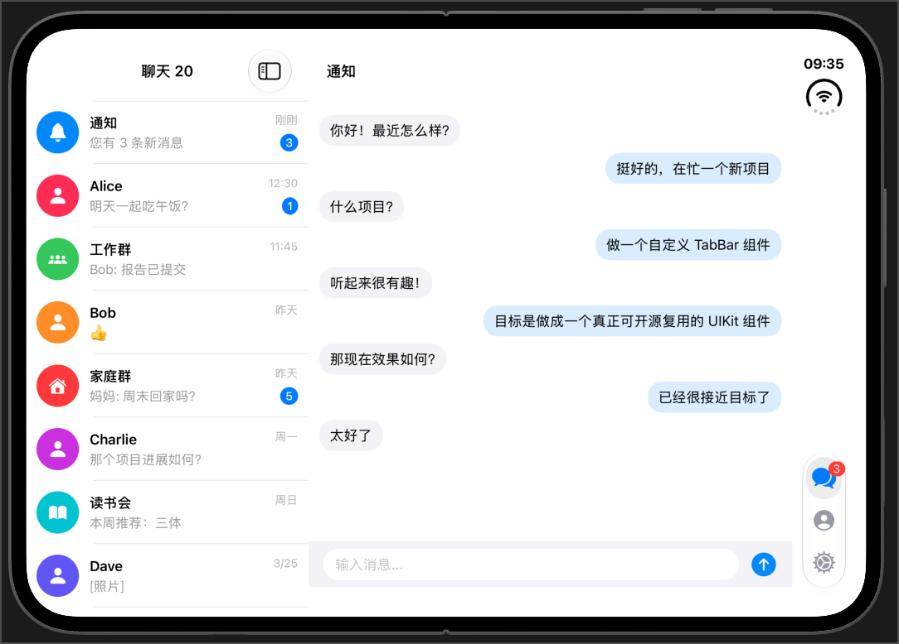
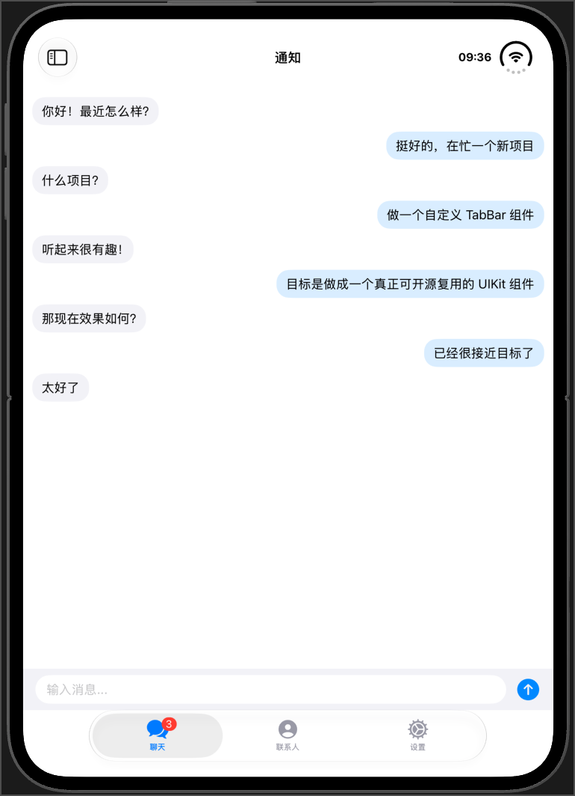
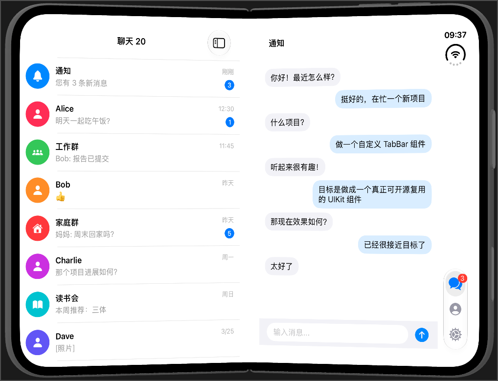

# TabBar

[](https://github.com/sunimp/TabBar/actions/workflows/ci.yml)
[](https://swift.org/package-manager/)
[](LICENSE)

UIKit 自定义 TabBar，支持浮动胶囊、液态选中效果、角标和 Lottie 图标动画，并适配 iPhone Duo 的侧边纵向布局。

## 特性

- iOS 15+、Swift Package Manager。
- `UIImage` 和 Lottie 图标。
- 亮色、暗色和自定义样式。
- 选中、重选、双击和长按回调。
- iPhone Duo 适配：跟随系统纵向栏轨道、避让摄像头与折叠区域、双栏 Demo。

## 安装

在 Xcode 中添加：

```text
https://github.com/sunimp/TabBar.git
```

或在 `Package.swift` 中添加：

```swift
.package(url: "https://github.com/sunimp/TabBar.git", from: "0.2.0")
```

## 快速开始

```swift
import TabBar
import UIKit

let controller = TabBarController()
controller.setViewControllers(
    [UIViewController(), UIViewController()],
    items: [
        TabBarItem(title: "首页", image: UIImage(systemName: "house")),
        TabBarItem(title: "设置", image: UIImage(systemName: "gear")),
    ]
)
```

主要类型：`TabBarController`、`TabBarView`、`TabBarItem`、`TabBarItemAnimation`、`TabBarStyle`。

## iPhone Duo

使用 iOS 27.1 SDK（Xcode 27.1+）构建时，`TabBarController` 按 [Designing for iPhone Duo](https://developer.apple.com/design/human-interface-guidelines/designing-for-iphone-duo) 自动适配，无需额外配置：

| 姿态 | TabBar 布局 |
| --- | --- |
| 闭合外屏（任意方向） | 纵向，位于系统纵向栏轨道底部，与摄像头、状态栏同列 |
| 展开内屏横握 | 纵向，位于屏幕侧边，与状态栏同列；分屏时位于本 App 一侧的系统纵向栏列 |
| 展开内屏竖握 | 横向，位于底部 |

- 纵向与否、所在侧和轨道 frame 均来自系统：`UITraitCollection.verticalBarEdge` 与 window 上的 `UIView.layoutGuide(for: .bar(onEdge:extent:))`。轨道宽 48pt，与系统纵向栏按钮一致；纵向时只显示图标。
- 纵向时长按向屏幕内侧展开并显示标题，上下滑动切换高亮，松手选中并收起；展开覆盖在内容之上，不改变 safe area，也不回调 `didLongPress`。
- 横向布局按 `reservedRegions(kind:)` 避开摄像头遮挡和折叠区域。
- TabBar 通过子控制器的 `additionalSafeAreaInsets` 避让；内容请约束到 `safeAreaLayoutGuide`，不要贴 `view` 边缘。
- 双栏布局推荐 `UISplitViewController`。Demo 的聊天、设置仅在 Duo 展开内屏（横纵 size class 均为 regular）显示列表 + 详情双栏；其它 iPhone 与 Duo 外屏为单栏，详情使用系统 push/pop，TabBar 随前一页一起移出。

## Demo

打开 `Demo/TabBarDemo.xcodeproj`，运行 `TabBarDemo` scheme。

| iOS 15+ 亮色 | iOS 15+ 暗色 |
| --- | --- |
|  |  |

| iOS 26+ 亮色 | iOS 26+ 暗色 |
| --- | --- |
|  |  |

iPhone Duo（Xcode Device Hub）：

| 闭合外屏 · 竖握 | 闭合外屏 · 横握 |
| --- | --- |
|  |  |

| 展开内屏 · 横握 | 展开内屏 · 竖握 |
| --- | --- |
|  |  |

| 半折叠 |
| --- |
|  |

闭合外屏：TabBar 纵向位于摄像头所在列，摄像头在上时贴轨道底部、在下时位于摄像头上方。展开内屏横握及半折叠：会话列表与详情双栏，TabBar 位于状态栏所在列。展开内屏竖握：TabBar 回到底部横向。

## 验证

CI 在 GitHub Actions 上使用 Xcode 26.6（macos-26）与 Xcode 27.1（xcode-27，preview 镜像）运行测试并构建 Demo。iPhone Duo 相关代码以 `#if compiler(>=6.4)` 隔离，只有 Xcode 27.1 会编译这部分，26.6 用于确认旧工具链仍可编译。iPhone Duo 姿态需本地使用 Xcode 27.1+ 的 Device Hub 验证。

运行测试：

```bash
xcodebuild test \
  -scheme TabBar \
  -destination "platform=iOS Simulator,id=${DESTINATION_ID}"
```

构建 Demo：

```bash
xcodebuild build \
  -project Demo/TabBarDemo.xcodeproj \
  -scheme TabBarDemo \
  -destination "generic/platform=iOS Simulator" \
  CODE_SIGNING_ALLOWED=NO
```

如需重新生成 Demo 工程：

```bash
cd Demo && xcodegen generate
```

## License

MIT，详见 [LICENSE](LICENSE)。
